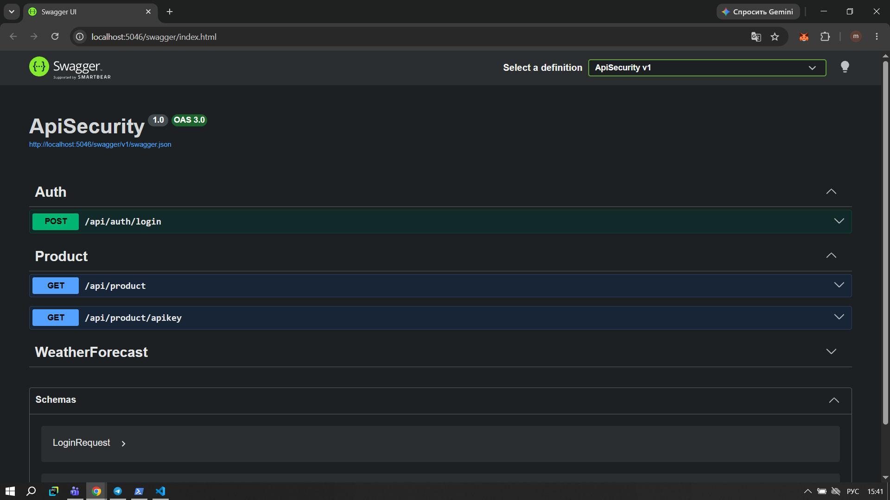
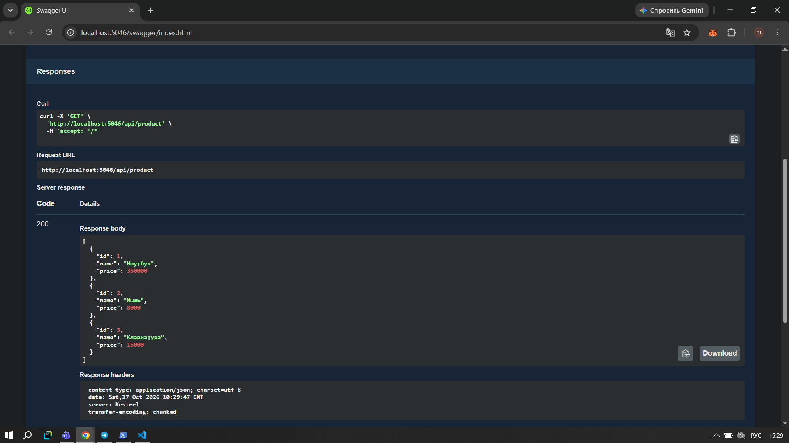
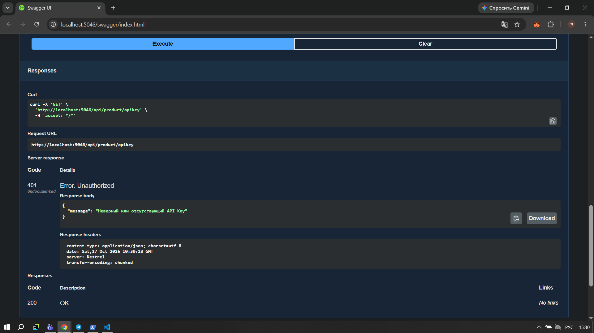
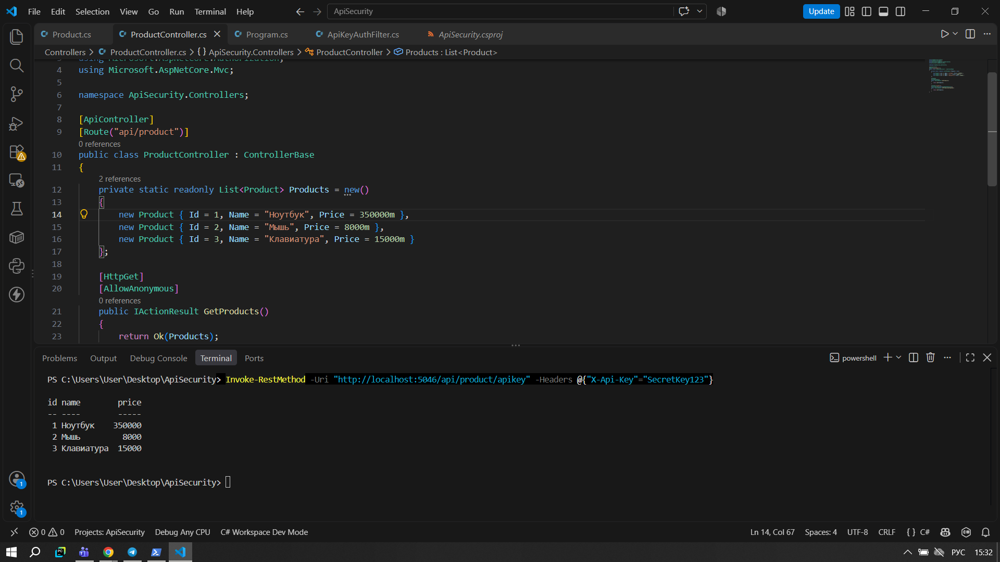
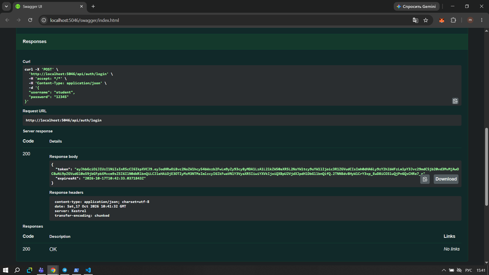
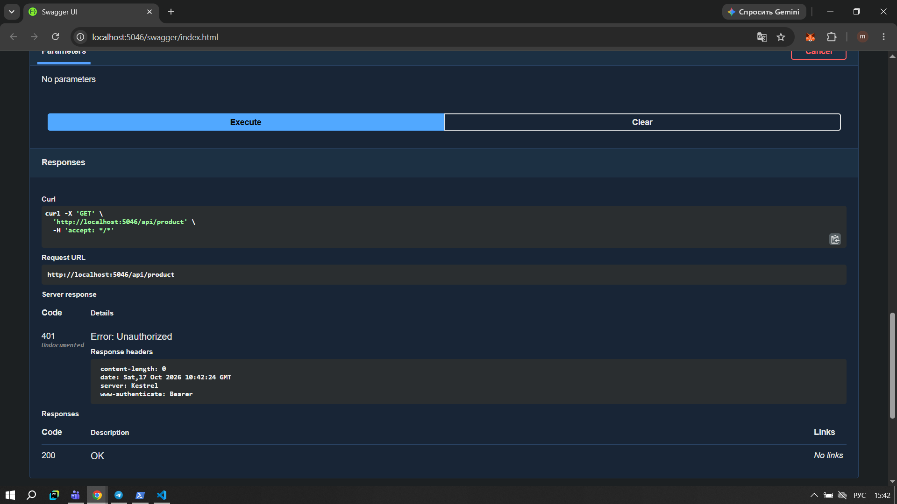
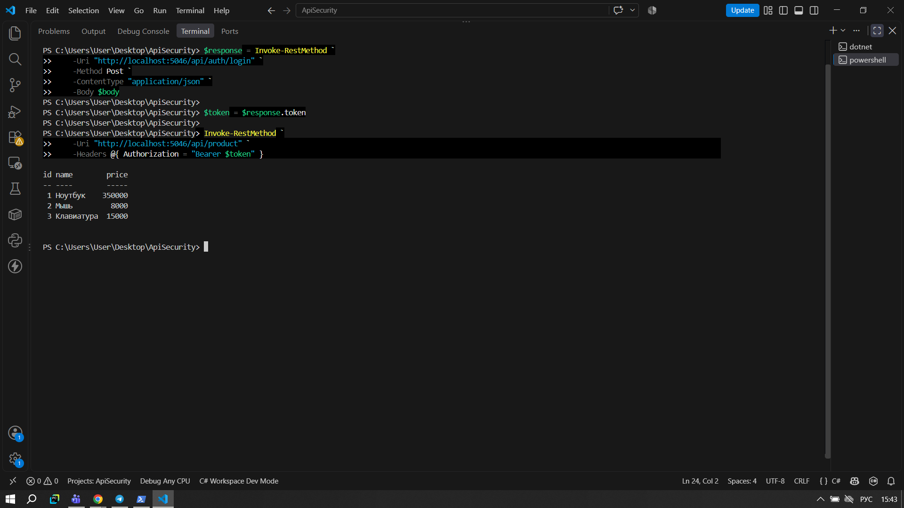
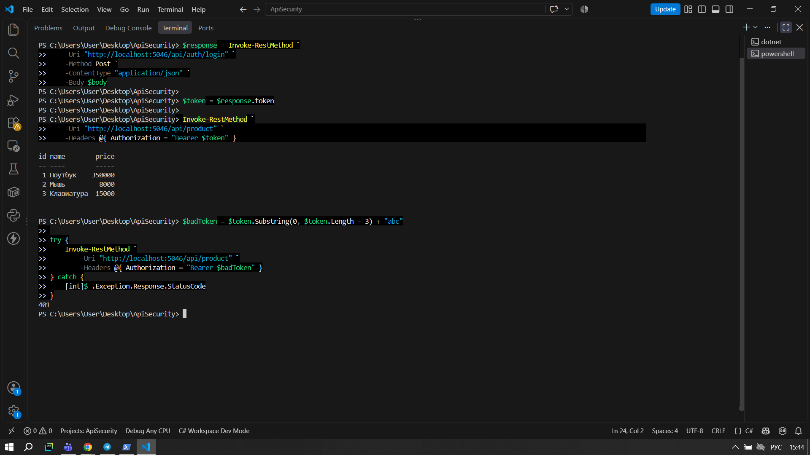
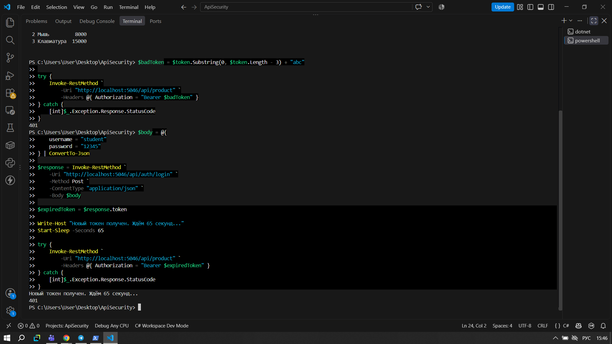

# Практическая работа №6. Защита доступа к API

## Цель работы

Цель работы - изучить способы защиты Web API, настроить проверку API Key и JWT-аутентификацию, а также проверить доступ к защищённым запросам.

## Используемые технологии

- C#
- ASP.NET Core Web API
- JWT Bearer Authentication
- Swagger
- PowerShell

## Ход работы

### 1. Создание Web API

Я создала Web API на ASP.NET Core и добавила модель `Product` с полями `Id`, `Name` и `Price`. Для проверки работы API реализовала получение списка товаров.

На скриншоте показан результат запроса в Swagger. Сервер возвращает список товаров с их идентификаторами, названиями и ценами.

### 2. Защита API с помощью API Key

Для проверки доступа я добавила фильтр `ApiKeyAuthFilter`, который проверяет значение заголовка `X-Api-Key`. Если ключ отсутствует или указан неправильно, сервер возвращает ошибку `401 Unauthorized`.

**Проверка без ключа.** При отправке запроса без API Key доступ отклоняется.

**Проверка неправильного ключа.** Я отправила запрос с неверным значением `X-Api-Key` и получила код `401`.

**Проверка правильного ключа.** После передачи ключа `SecretKey123` сервер успешно обработал запрос и вернул список товаров.

### 3. Реализация JWT-аутентификации

Я создала `AuthController` с endpoint `POST /api/auth/login`. Для входа используются логин `student` и пароль `12345`. При правильных данных сервер создаёт JWT-токен и возвращает его вместе со временем окончания действия.

### 4. Проверка доступа с помощью JWT

Я добавила атрибут `[Authorize]` к методу получения списка товаров. Теперь для доступа к `GET /api/product` необходимо передавать токен в заголовке `Authorization` в формате `Bearer`.

**Запрос без токена.** Если токен не передан, сервер возвращает `401 Unauthorized`.

**Запрос с действительным токеном.** После входа я передала полученный JWT в заголовке `Authorization`. Сервер проверил токен и вернул список товаров.

### 5. Проверка неправильного и просроченного токена

Чтобы проверить обработку ошибок авторизации, я изменила полученный токен и повторила запрос. Сервер отклонил его и вернул `401 Unauthorized`.

Затем я получила новый токен, дождалась окончания срока его действия и повторила запрос. Сервер также вернул `401 Unauthorized`, так как токен больше не являлся действительным.

## Результаты работы

В ходе тестирования были получены следующие результаты:

| Проверка | Результат |
|---|---|
| API Key отсутствует | `401 Unauthorized` |
| API Key неправильный | `401 Unauthorized` |
| API Key правильный | `200 OK` |
| Успешный вход и получение JWT | `200 OK` |
| Запрос без JWT | `401 Unauthorized` |
| Запрос с действительным JWT | `200 OK` |
| Изменённый JWT | `401 Unauthorized` |
| Просроченный JWT | `401 Unauthorized` |

## Вывод

В ходе практической работы я реализовала два способа защиты Web API: API Key и JWT. Я проверила получение токена, доступ к защищённому endpoint и обработку ошибок авторизации. В результате убедилась, что сервер предоставляет доступ при корректных данных и отклоняет запросы с отсутствующими, неправильными или просроченными данными авторизации.
