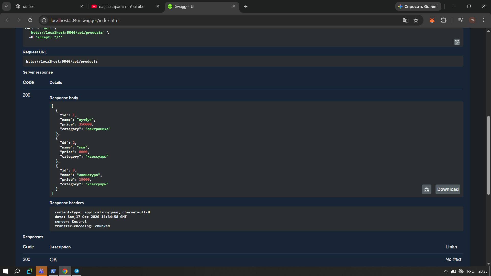
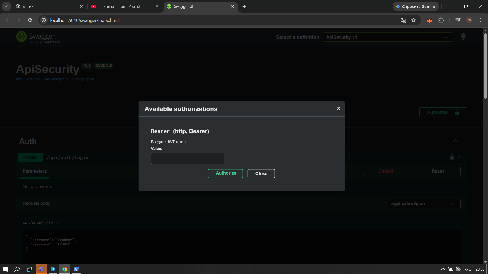
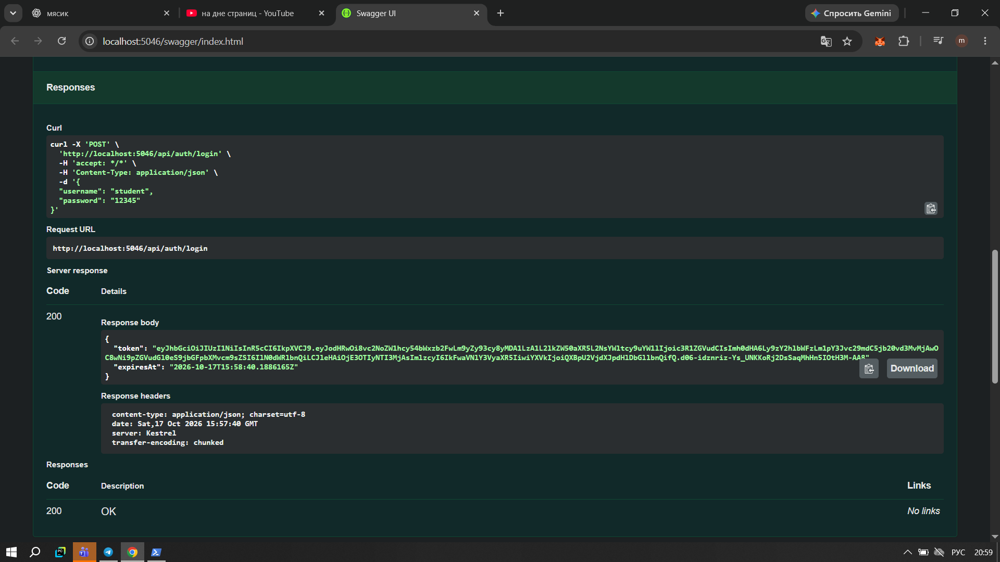
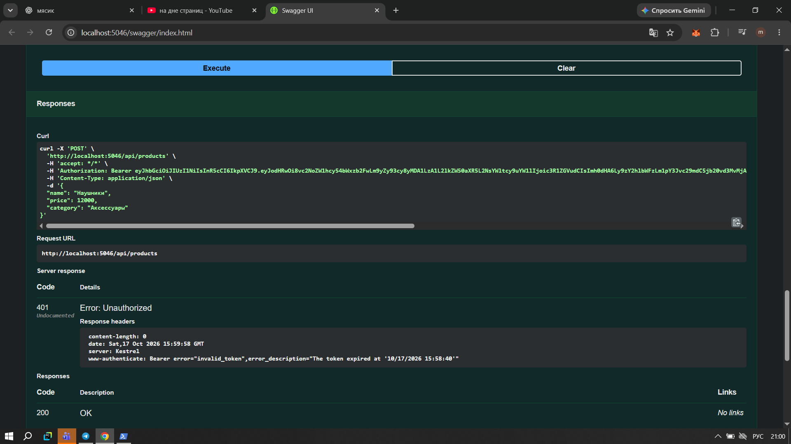
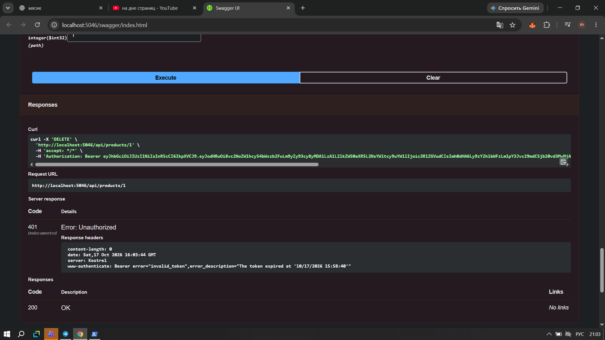
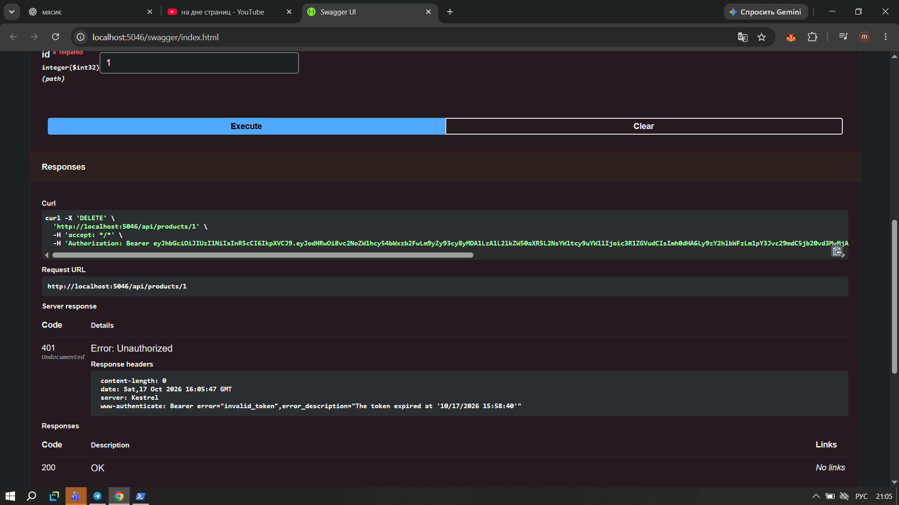

# Модуль 06 - Защита доступа к API с помощью JWT

## 1. Цель работы

Цель работы - разработать Web API для управления товарами и настроить защиту отдельных запросов с помощью JWT-токенов. Также нужно проверить, как API ведёт себя при запросах с токеном и без него.

## 2. Используемые технологии

- C#
- ASP.NET Core Web API
- .NET 10
- JWT (JSON Web Token)
- Swagger UI

## 3. Описание проекта

В проекте реализован API для работы со списком товаров. Каждый товар содержит следующие поля:

- `Id` - идентификатор товара;
- `Name` - название;
- `Price` - цена;
- `Category` - категория.

Для демонстрации используются три начальных товара: ноутбук, мышь и клавиатура.

## 4. Реализованные запросы

| Метод | Адрес | Назначение | Доступ |
|---|---|---|---|
| GET | `/api/products` | Получить список товаров | Без токена |
| GET | `/api/products/{id}` | Получить товар по ID | Без токена |
| POST | `/api/products` | Добавить товар | Требуется JWT |
| DELETE | `/api/products/{id}` | Удалить товар | Требуется JWT |
| POST | `/api/auth/login` | Получить JWT-токен | Без токена |
| GET | `/api/auth/me` | Получить имя текущего пользователя | Требуется JWT |

## 5. Настройка JWT

Для входа используются тестовые данные:

- Логин: `student`
- Пароль: `12345`

При успешном входе сервер создаёт JWT-токен. В нём содержится имя пользователя и роль. Токен имеет ограниченное время действия.

При обращении к защищённым запросам сервер проверяет подпись токена, издателя, аудиторию и срок действия. Если токен отсутствует или недействителен, сервер возвращает `401 Unauthorized`.

Имя пользователя при создании товара извлекается из claims текущего пользователя. Это позволяет определить, кто выполнил запрос.

## 6. Проверка работы

Для проверки использовался Swagger UI.

### 6.1. Получение списка товаров

Запрос `GET /api/products` выполняется без авторизации и возвращает список товаров со статусом `200 OK`.

### 6.2. Получение JWT-токена

Для получения токена отправляется запрос `POST /api/auth/login` с тестовым логином и паролем. При правильных данных сервер возвращает токен и время его окончания.

### 6.3. Создание товара без токена

При попытке выполнить `POST /api/products` без авторизации сервер возвращает `401 Unauthorized`. Это подтверждает, что создание товара защищено.

### 6.4. Создание товара с токеном

После добавления действующего JWT в Swagger запрос `POST /api/products` выполняется успешно и возвращает `201 Created`. В ответе отображаются данные нового товара и имя пользователя.

### 6.5. Удаление товара с токеном

Запрос `DELETE /api/products/{id}` с действующим токеном позволяет удалить товар. При успешном удалении сервер возвращает `200 OK`.

### 6.6. Удаление товара без токена

При выполнении DELETE-запроса без токена сервер возвращает `401 Unauthorized`. Таким образом, удаление также защищено авторизацией.

## 7. Результат работы

В ходе работы я реализовала API для управления товарами и настроила JWT-авторизацию. Проверила доступность GET-запросов без токена, получение JWT при входе, создание и удаление товаров с авторизацией, а также отказ в доступе без токена.

В результате получилось разделить открытые запросы и операции, для которых требуется подтверждение пользователя с помощью JWT.
