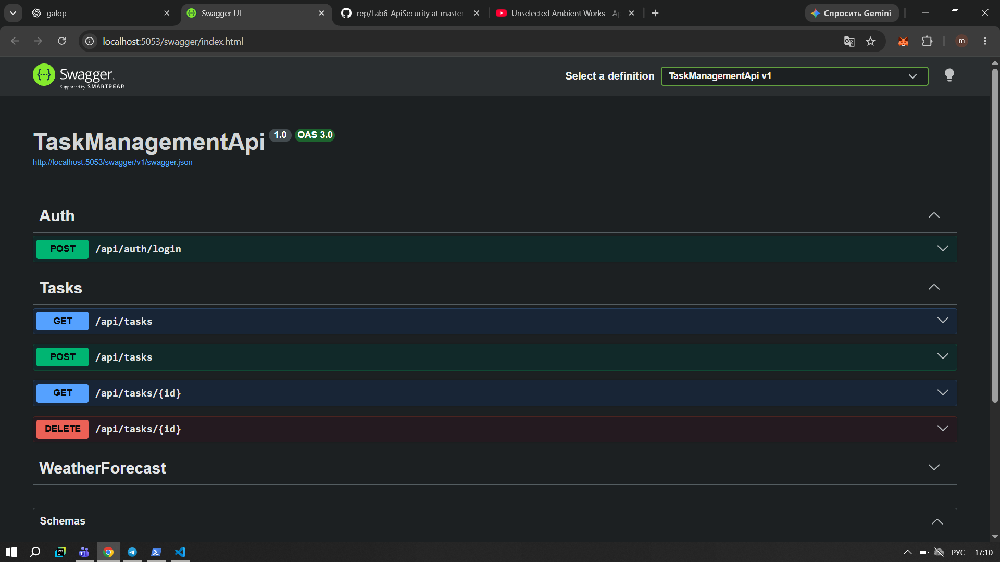
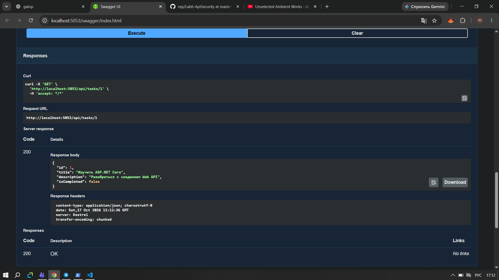
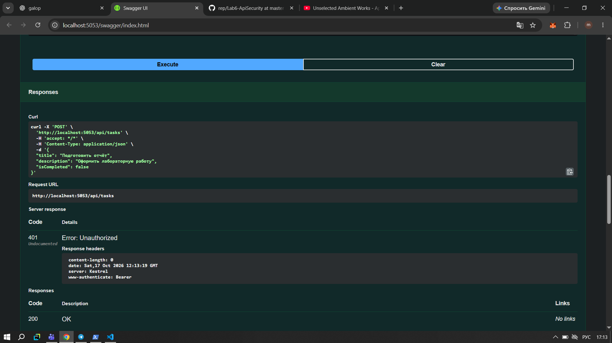
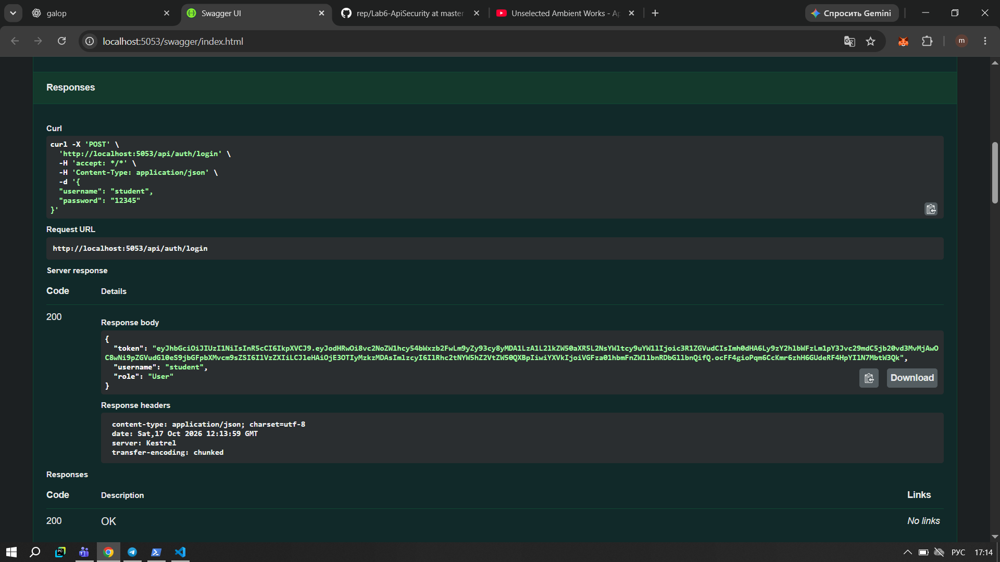
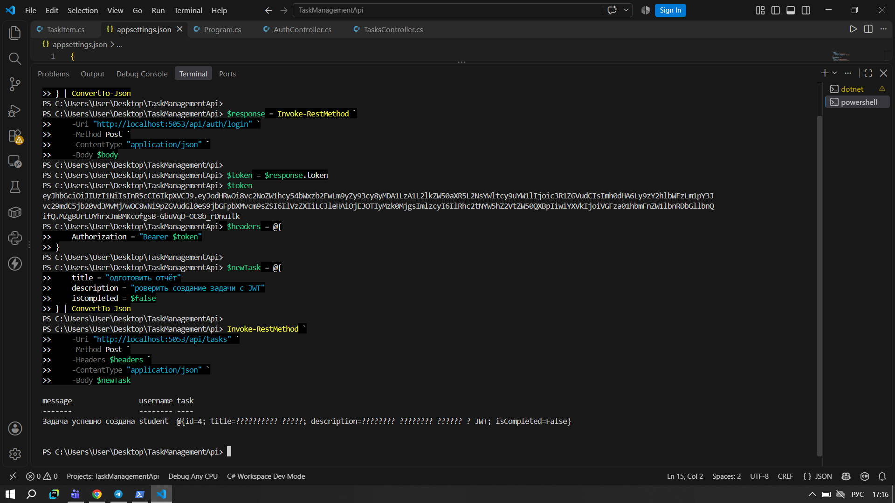
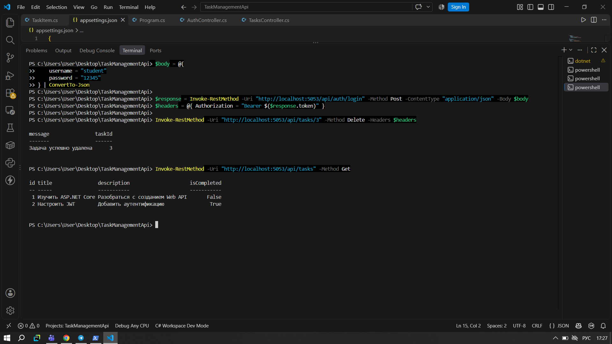
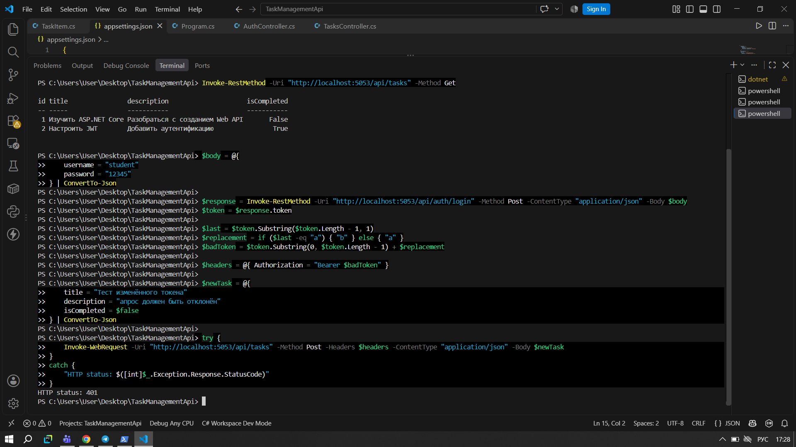
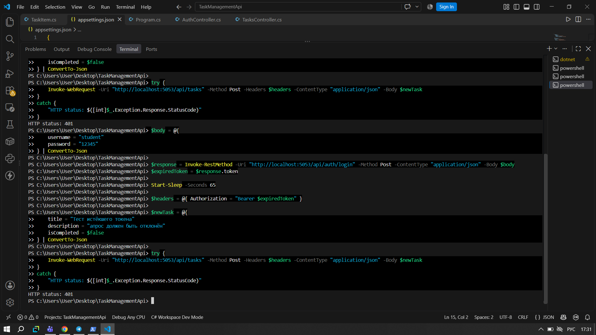

# Лабораторная работа 6. Защита доступа к API

## 1. Цель работы

Цель лабораторной работы - создать Web API для управления задачами и настроить защиту отдельных методов с помощью JWT-токенов. Также необходимо проверить, как API обрабатывает запросы без токена, с изменённым токеном и с истёкшим сроком действия.

## 2. Создание проекта

Для выполнения работы я создала проект `TaskManagementApi` на ASP.NET Core Web API. Для тестирования методов использовала Swagger UI и PowerShell.

В проекте были созданы модели задач и контроллеры для авторизации и управления задачами. Каждая задача содержит идентификатор, название, описание и статус выполнения.

**Скриншот 1 - Swagger UI**

## 3. Получение списка задач

Сначала я проверила получение списка задач через метод `GET /api/tasks`. Этот метод доступен без авторизации, поэтому для запроса не требуется JWT-токен.

В ответ сервер вернул список существующих задач с их идентификаторами, названиями, описаниями и статусами выполнения. Запрос завершился успешно с кодом HTTP 200.

**Скриншот 2 - Получение списка задач**

## 4. Проверка доступа без токена

После этого я проверила защищённый метод `POST /api/tasks`, который используется для создания новой задачи.

Я отправила запрос без токена авторизации. Сервер отклонил его и вернул код HTTP 401 Unauthorized. Это показывает, что нельзя создавать задачи без прохождения авторизации.

**Скриншот 3 - Запрос на создание задачи без токена**

## 5. Получение JWT-токена

Для авторизации я использовала метод `POST /api/auth/login`. В запросе указала тестовые данные: логин `student` и пароль `12345`.

После проверки данных сервер сформировал JWT-токен. Он содержит информацию о пользователе и его роли. В дальнейшем токен используется для доступа к защищённым методам API.

**Скриншот 4 - Успешная авторизация**

## 6. Создание задачи с JWT-токеном

Затем я повторила запрос `POST /api/tasks`, но уже передала действительный JWT-токен в заголовке `Authorization`.

На этот раз сервер разрешил выполнить запрос и вернул сообщение об успешном создании задачи. В ответе также отображается имя пользователя, выполнившего операцию.

**Скриншот 5 - Создание задачи с токеном**

## 7. Удаление задачи с JWT-токеном

Далее я проверила метод `DELETE /api/tasks/{id}`. Для проверки выбрала задачу с идентификатором 3 и отправила запрос с действительным токеном.

Сервер подтвердил удаление задачи. После этого я повторно запросила список задач и убедилась, что задача с ID 3 больше не отображается.

**Скриншот 6 - Удаление задачи**

## 8. Проверка изменённого токена

Чтобы проверить дополнительную защиту, я изменила JWT-токен и попыталась создать задачу с его помощью.

Сервер отклонил запрос и вернул HTTP 401 Unauthorized. Это означает, что изменённый токен не прошёл проверку подписи и не может использоваться для доступа к защищённому методу.

**Скриншот 7 - Запрос с изменённым токеном**

## 9. Проверка срока действия токена

В настройках проекта для JWT установлен срок действия в одну минуту. Я получила новый токен, подождала 65 секунд и повторила запрос на создание задачи.

Поскольку срок действия токена истёк, сервер вернул HTTP 401 Unauthorized и не разрешил выполнить операцию.

**Скриншот 8 - Запрос с истёкшим токеном**

## 10. Результаты работы

В ходе тестирования я получила следующие результаты:

| Проверка | Результат |
|---|---|
| Получение списка задач без авторизации | HTTP 200 |
| Получение задачи по ID | HTTP 200 |
| Создание задачи без токена | HTTP 401 |
| Авторизация с правильными данными | JWT-токен выдан |
| Создание задачи с действительным токеном | Успешно |
| Удаление задачи с действительным токеном | Успешно |
| Использование изменённого токена | HTTP 401 |
| Использование истёкшего токена | HTTP 401 |

## 11. Вывод

В этой лабораторной работе я создала Web API для управления задачами и настроила JWT-аутентификацию. Я проверила получение и удаление задач, создание новых записей и работу защиты на практике. В результате убедилась, что защищённые методы доступны только при наличии действительного токена, а запросы с недействительным или истёкшим токеном отклоняются.